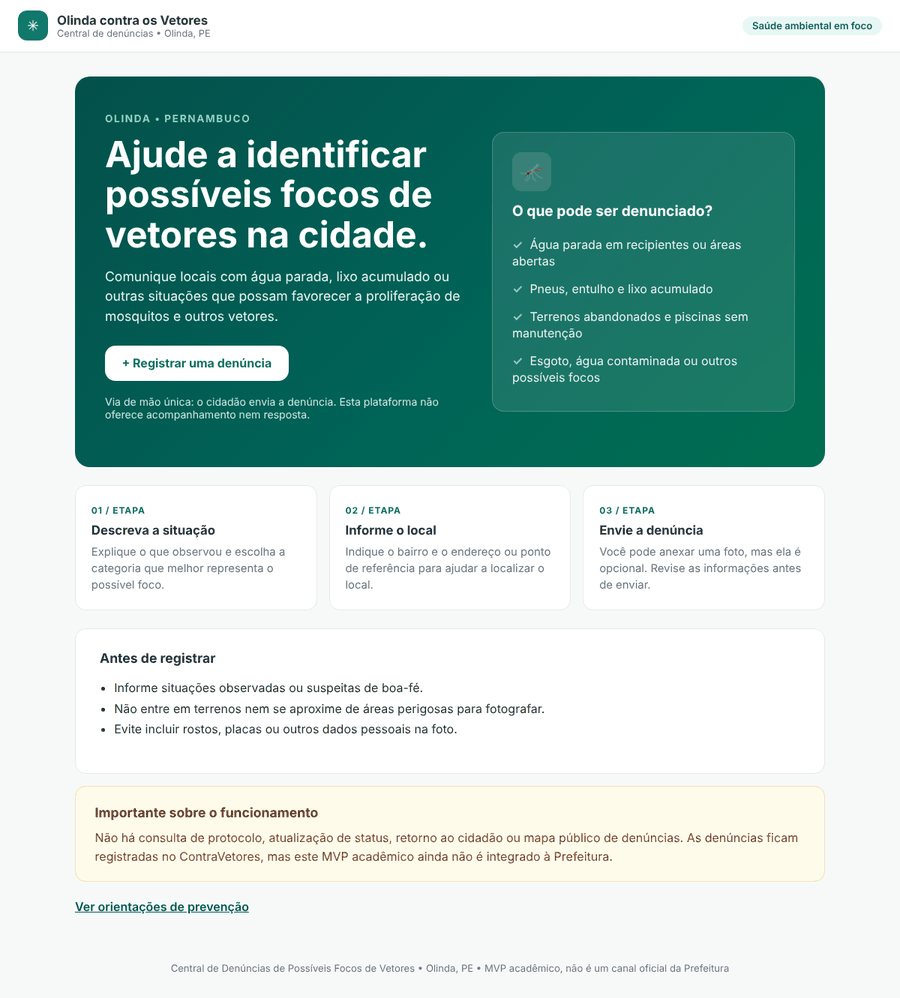
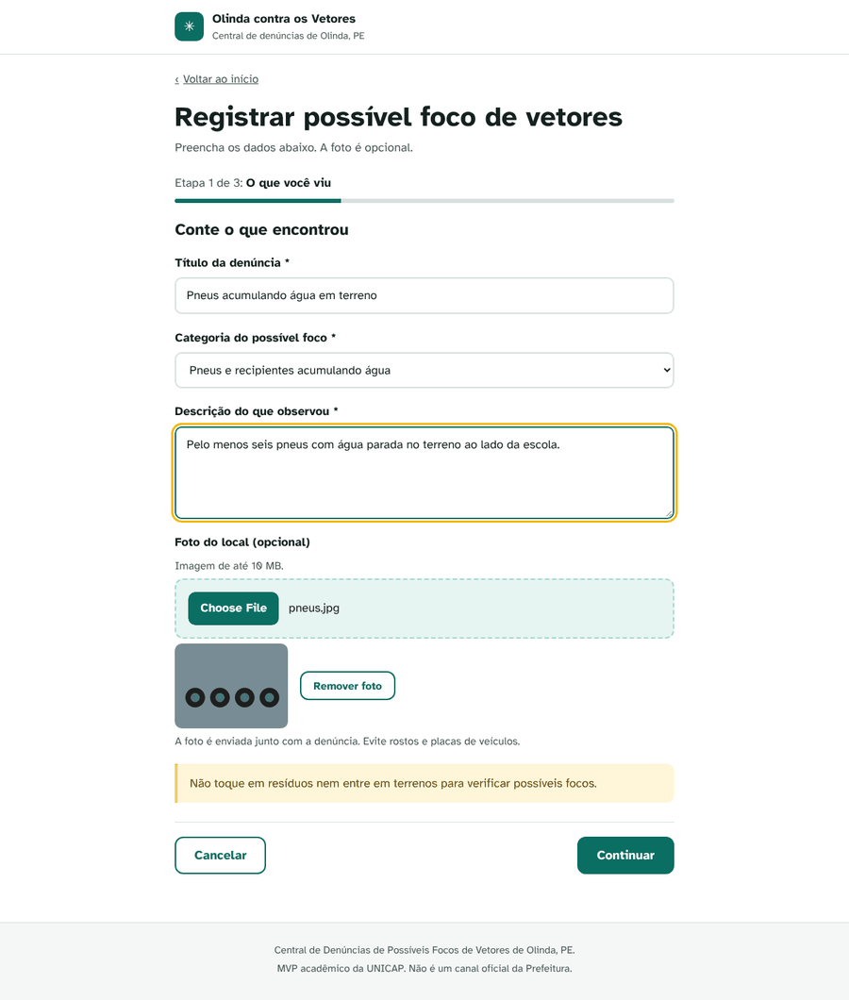
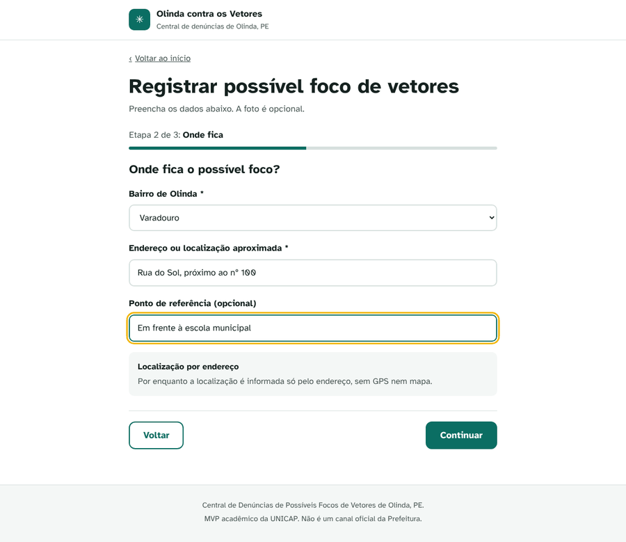
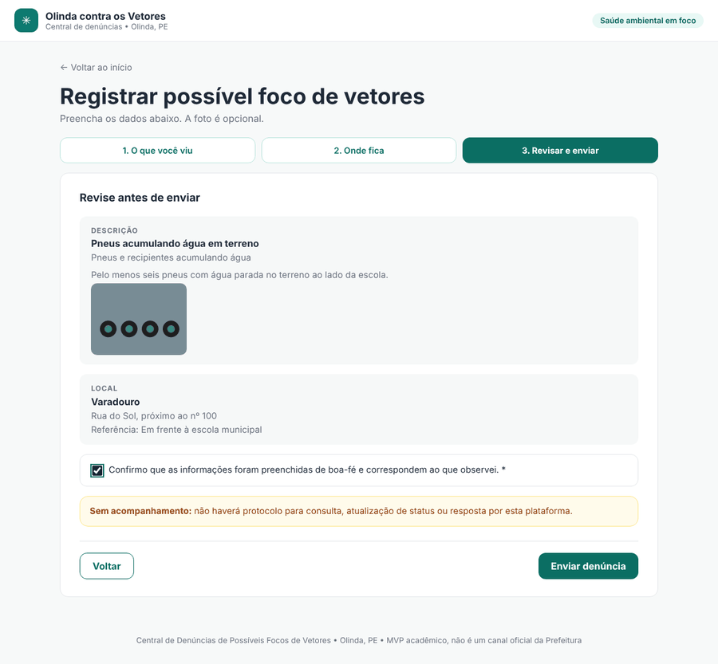
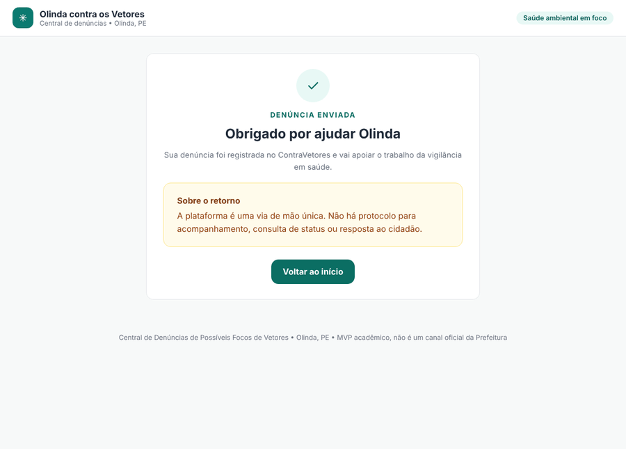
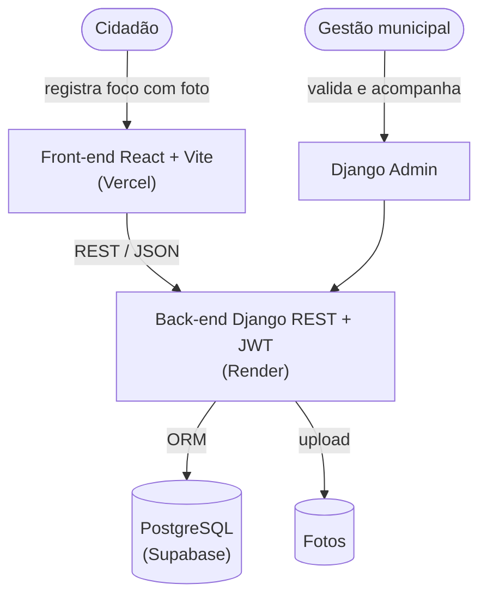
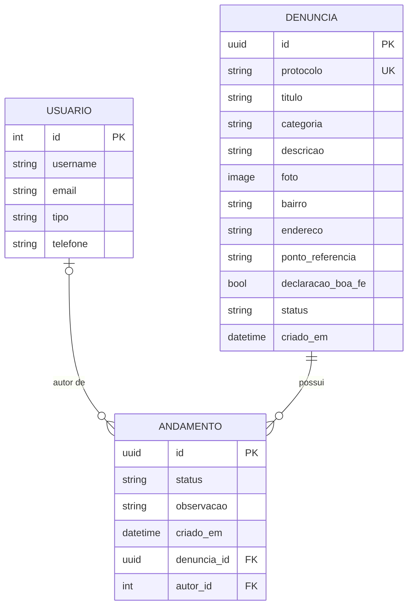

# ContraVetores

> Central de denúncias de focos de proliferação de vetores em Olinda (PE).


**Acesse:** _link público do front (Vercel) a preencher após o deploy_ · **API:** _link do Render a preencher_

---

## Sumário

- [Visão geral](#visão-geral)
- [Como usar o site](#como-usar-o-site)
- [Arquitetura](#arquitetura)
- [API](#api)
- [Rodando localmente](#rodando-localmente)
- [Banco de dados](#banco-de-dados)
- [Deploy](#deploy)
- [Testes](#testes)
- [Documentos entregues](#documentos-entregues)
- [Entregas](#entregas)
- [Equipe](#equipe)

---

## Visão geral

O ContraVetores é uma plataforma web colaborativa onde a população de Olinda registra focos de risco (água parada, lixo acumulado, terrenos abandonados, piscinas sem manutenção) com foto e localização. Os relatos viram dados organizados que orientam a fiscalização da vigilância em saúde e encurtam o tempo entre o surgimento de um foco e a resposta do poder público.

Em uma frase: transformar a população em sensor da cidade, convertendo relato disperso em dado que prioriza a ação dos agentes de saúde.

> [!NOTE]
> Projeto acadêmico de inovação social da UNICAP, com patrocínio simulado da Secretaria de Saúde da Prefeitura de Olinda. É um MVP universitário: o escopo prioriza os requisitos que fazem sentido para o problema, não um produto pronto para produção.

O front-end segue o protótipo de alta fidelidade (HiFi) entregue na Etapa 02: [smoothly-castle-2003 no MagicPath](https://designs.magicpath.ai/v1/smoothly-castle-2003).

---

## Como usar o site

O site é uma **via de mão única**: o cidadão envia a denúncia e não há login, protocolo, consulta de status ou resposta. A gestão municipal acompanha as denúncias pelo painel administrativo (`/admin`).

### 1. Página inicial

Explica o que pode ser denunciado, as três etapas do formulário e os cuidados antes de registrar. O botão **Registrar uma denúncia** abre o formulário. O link **Ver orientações de prevenção** mostra como reconhecer focos sem se expor a riscos.



### 2. Etapa 1: O que você viu

Informe um **título**, escolha a **categoria** do possível foco e **descreva** o que observou. A **foto é opcional** (até 10 MB) e pode ser removida antes de continuar.



### 3. Etapa 2: Onde fica

Escolha o **bairro de Olinda**, informe o **endereço ou localização aproximada** e, se quiser, um **ponto de referência**.



### 4. Etapa 3: Revisar e enviar

Confira o resumo, marque a **declaração de boa-fé** e clique em **Enviar denúncia**. Se faltar algum campo obrigatório, a mensagem aparece abaixo dele.



### 5. Confirmação

A denúncia fica gravada no banco de dados com o status `RECEBIDA`.



### Para a gestão municipal

Acesse `/admin` na URL da API com um usuário criado por `createsuperuser`. Lá é possível filtrar por status, categoria e bairro, ver a foto e registrar andamentos (recebida, validada, rejeitada, resolvida). Cada andamento guarda autor, data e observação.

---

## Arquitetura



O front-end apresenta a landing, as orientações e o formulário de denúncia. O back-end concentra as regras, a validação e a autenticação. Os dados ficam no PostgreSQL. Nenhuma camada acessa a outra pulando o back-end.

### Stack

| Camada | Tecnologia |
| --- | --- |
| Front-end | React 19, React Router 7, Vite 6 |
| Back-end | Python, Django 5.2, Django REST Framework |
| Autenticação | JWT (djangorestframework-simplejwt) para as rotas da gestão |
| Banco de dados | PostgreSQL via `DATABASE_URL` (Supabase em produção); SQLite como alternativa local |
| Upload de imagens | Pillow |
| Servidor | gunicorn + WhiteNoise |
| Hospedagem | Vercel (front) e Render (API) |

Em relação ao documento da Etapa 02, o mapa com Leaflet, o PostGIS e o dashboard em Power BI ficaram fora do MVP. A localização é informada por bairro, endereço e ponto de referência, como no HiFi.

### Modelo de dados



- **Usuario**: a gestão municipal e os agentes de saúde. O cidadão não tem conta, o que mantém a denúncia anônima (LGPD).
- **Denuncia**: o foco reportado. `categoria` e `bairro` aceitam apenas os valores do HiFi. O `protocolo` é gerado para uso interno da gestão.
- **Andamento**: o histórico de cada denúncia. Cada mudança de `status` registra quem fez, quando e uma observação.

### Estrutura do repositório

```
contravetores/        Configuração do Django (settings, urls, wsgi, asgi)
denuncias/            App principal
  models.py           Usuario, Denuncia e Andamento
  serialyzers.py      Serializers e validações da API
  views.py            Endpoints públicos e da gestão
  admin.py            Painel da gestão (Django Admin)
  management/         Comando seed_denuncias (dados sintéticos)
  migrations/         Migrações do banco
  tests.py            Testes da API
frontend/             App React (Vite)
  src/pages/          Inicio, Orientacoes e NovaDenuncia
  vercel.json         Rotas do React Router no Vercel
docs/                 Documentos entregues e imagens do README
render.yaml           Deploy da API no Render
dev.py                Prepara e sobe o ambiente de desenvolvimento
.env.example          Modelo do arquivo .env
```

---

## API

| Método | Rota | O que faz | Acesso |
| --- | --- | --- | --- |
| POST | `/auth/login` | Recebe `username` e `password`, devolve tokens JWT | Público |
| POST | `/auth/refresh` | Renova o token de acesso | Público |
| POST | `/api/denuncias` | Registra uma denúncia (multipart, foto opcional) | Público |
| GET | `/api/denuncias/{protocolo}` | Detalha uma denúncia pelo protocolo | Público |
| GET | `/api/admin/denuncias` | Lista todas as denúncias | Gestão (JWT) |
| GET | `/api/admin/denuncias/{protocolo}` | Detalha uma denúncia com histórico | Gestão (JWT) |
| POST | `/api/admin/denuncias/{protocolo}/andamentos` | Registra andamento e atualiza o status | Gestão (JWT) |

Exemplo de criação:

```bash
curl -X POST http://localhost:8000/api/denuncias \
  -F titulo="Pneus acumulando água" \
  -F categoria="Pneus e recipientes acumulando água" \
  -F descricao="Seis pneus com água parada no terreno" \
  -F bairro="Varadouro" \
  -F endereco="Rua do Sol, 100" \
  -F ponto_referencia="Em frente à escola" \
  -F declaracao_boa_fe=true \
  -F foto=@foto.jpg
```

Resposta `201`:

```json
{
  "protocolo": "EA80E245",
  "titulo": "Pneus acumulando água",
  "categoria": "Pneus e recipientes acumulando água",
  "descricao": "Seis pneus com água parada no terreno",
  "foto": "https://<api>/media/denuncias/foto.jpg",
  "bairro": "Varadouro",
  "endereco": "Rua do Sol, 100",
  "ponto_referencia": "Em frente à escola",
  "declaracao_boa_fe": true,
  "status": "RECEBIDA",
  "criado_em": "2026-10-28T18:04:16.112718-03:00",
  "andamentos": []
}
```

Erros de validação voltam com `400` e a mensagem por campo, por exemplo `{"endereco": ["Este campo é obrigatório."]}`.

---

## Rodando localmente

Pré-requisitos: Python 3.12+ e Node.js 20+.

### Jeito rápido: `dev.py`

```bash
git clone https://github.com/joaocarloss112/ContraVetores
cd ContraVetores
python dev.py
```

O script faz tudo sozinho e sobe os dois servidores no mesmo terminal:

1. Cria o `venv` (se não existir) e instala o `requirements.txt` (só quando ele muda)
2. Aplica as migrações no banco
3. Pede para criar o usuário da gestão, se ainda não houver nenhum
4. Instala as dependências do front (só quando o `package-lock.json` muda)
5. Sobe a API em `http://127.0.0.1:8000` e o site em `http://127.0.0.1:5173`

`Ctrl+C` para os dois. Opções:

| Comando | O que faz |
| --- | --- |
| `python dev.py --seed` | Gera 20 denúncias fictícias antes de subir |
| `python dev.py --so-api` | Sobe só o back-end |
| `python dev.py --so-preparar` | Instala e migra, sem subir servidores |

### Passo a passo manual

<details>
<summary>Mesmos passos do <code>dev.py</code>, comando por comando</summary>

```bash
python -m venv venv
source venv/bin/activate          # Windows: venv\Scripts\activate
pip install -r requirements.txt
python manage.py migrate
python manage.py createsuperuser  # login da gestão no /admin
python manage.py seed_denuncias   # opcional: 20 denúncias fictícias
python manage.py runserver
```

Em outro terminal:

```bash
cd frontend
npm install
npm run dev
```

</details>

Em desenvolvimento, o Vite encaminha `/api`, `/auth` e `/media` para o Django, então o front não precisa de configuração.

---

## Banco de dados

O Django lê as configurações de um arquivo `.env` na raiz do projeto (que não é versionado). Sem `DATABASE_URL`, usa um `db.sqlite3` local.

Para usar o PostgreSQL do Supabase:

1. Copie o `.env.example` para `.env`.
2. Descomente a linha `DATABASE_URL` e cole a string de conexão (veja [Deploy > Banco](#1-banco-supabase)).
3. Rode `python dev.py`. As migrações vão para o Supabase.

Variáveis definidas no terminal ou no painel da hospedagem têm prioridade sobre o `.env`.

| Variável | Para que serve | Padrão |
| --- | --- | --- |
| `DATABASE_URL` | Conexão com o PostgreSQL | SQLite local |
| `DEBUG` | `false` em produção | `true` |
| `SECRET_KEY` | Chave do Django, obrigatória com `DEBUG=false` | chave de desenvolvimento |
| `ALLOWED_HOSTS` | Domínios aceitos pela API, separados por vírgula | `*` |
| `CORS_ALLOWED_ORIGINS` | Domínio do front autorizado a chamar a API | todos, só com `DEBUG=true` |
| `CSRF_TRUSTED_ORIGINS` | Domínios confiáveis para formulários do `/admin` | vazio |
| `SERVE_MEDIA` | Django serve as fotos enviadas | igual ao `DEBUG` |
| `VITE_API_URL` | (front) URL da API no build do Vercel | mesma origem |

---

## Deploy

### 1. Banco (Supabase)

1. Crie um projeto no [Supabase](https://supabase.com). Região: **East US (North Virginia)**, a mesma do Render no `render.yaml`, para a API e o banco ficarem perto. Guarde a senha do banco.
   Em **Security**, desmarque **Enable Data API**: o Django acessa o banco direto, e com essa opção ligada as tabelas ficariam expostas pela API REST do Supabase.
2. No topo do projeto, clique em **Connect** e copie a URI do **Session pooler** (ela funciona em redes só IPv4, como a do Render).
3. Cole no `.env` como `DATABASE_URL`, trocando `[YOUR-PASSWORD]` pela senha. Se a senha tiver caracteres como `@`, `#` ou `/`, troque por uma só com letras e números.
4. Rode `python dev.py --seed --so-preparar`. Isso cria as tabelas, o usuário da gestão e dados de exemplo no Supabase.
5. Confira em **Table Editor**: devem aparecer as tabelas `denuncias_denuncia`, `denuncias_andamento` e `denuncias_usuario`.

### 2. API (Render)

1. No [Render](https://render.com), **New > Blueprint** e escolha este repositório. O `render.yaml` já define build, start e variáveis.
2. Preencha `DATABASE_URL` com a string do Supabase e `CORS_ALLOWED_ORIGINS` com a URL do Vercel (pode atualizar depois do passo 3).
3. Ao final do deploy, confira `https://<servico>.onrender.com/admin/`.

### 3. Front-end (Vercel)

1. No [Vercel](https://vercel.com), **Add New > Project** e importe o repositório.
2. **Root Directory:** `frontend`. O framework Vite é detectado sozinho.
3. Em **Environment Variables**, crie `VITE_API_URL` com a URL da API do Render, sem barra no final.
4. Faça o deploy e coloque a URL gerada em `CORS_ALLOWED_ORIGINS` no Render.

> [!WARNING]
> No plano gratuito do Render a API "dorme" após um período sem uso e a primeira requisição pode levar até um minuto. O disco também não é permanente: fotos enviadas somem a cada novo deploy. Para a banca, vale abrir o site alguns minutos antes.

---

## Testes

```bash
python manage.py test
```

Os testes cobrem a criação de denúncia (com e sem foto), as validações do formulário (boa-fé, endereço, categoria, bairro e limite de 10 MB da foto), a consulta por protocolo, o login JWT e o registro de andamento pela gestão.

---

## Documentos entregues

| Etapa | Documento |
| --- | --- |
| 02/06 | [Escolhas computacionais](docs/etapa-02/escolhas-computacionais.md) |
| 02/06 | [Contratos de API (versão prevista)](docs/etapa-02/contratos-api.md) |
| 02/06 | [Diagrama de arquitetura (PDF)](docs/etapa-02/arquitetura.pdf) |
| 02/06 | [Modelagem de dados](docs/etapa-02/modelo-de-dados.png) |
| 02/06 | [Protótipo HiFi no MagicPath](https://designs.magicpath.ai/v1/smoothly-castle-2003) |

---

## Entregas

### Entregue

**Etapa 01/06: Projeto de inovação social** (18/09/2026)
- [x] Proposta ContraVetores, definição e atores de inovação social
- [x] Análise SWOT, agentes de fomento e custo estimado
- [x] Detalhamento do método e pitching

**Etapa 02/06: Escolhas computacionais** (14/10/2026)
- [x] Diagrama de arquitetura (front, back e dados)
- [x] Modelagem de dados inicial e contratos de API
- [x] Protótipo de alta fidelidade (HiFi)

**Etapa 03/06: Mitigação de risco e validação ponta a ponta** (16/10/2026)
- [x] Repositório Git com o core do back-end (Django REST)
- [x] Fluxo de denúncia "happy path" dentro do escopo do HiFi

**Etapa 04/06: MVP integrado e beta** (28/10/2026)
_Fazer o sistema funcionar de ponta a ponta e testar com usuários reais._
- [x] Desenvolvimento do Front-end (baseado no HiFi entregue)
- [x] Determinar a arquitetura Back-end (com dados sintéticos via seed)
- [x] Aplicação "publicada" disponível para uso a nível de desenvolvimento

### Objetivos até a entrega final

> [!NOTE]
> Compromissos enxutos, na estratégia de MVP universitário: poucos itens por etapa, para prometer só o que dá para entregar.

- [x] Versionamento no GitHub do código do sistema
- [x] README mostrando como usar o site, com os documentos já entregues
- [x] Conexão com banco de dados (PostgreSQL via `DATABASE_URL`)
- [ ] HiFi validado e disponível via Vercel (configuração pronta, falta publicar e colocar o link no topo)

**Etapa 05/06: Ensaio e preparação para a banca** (11/11/2026)
_Blindar a aplicação e preparar a apresentação._
- [ ] a definir
- [ ] Curva S do fluxo do usuário
- [ ] Pipeline simples de testes de fluxo do sistema

**Etapa 06/06: Entrega final** (18/11/2026)
_Ajustar e entregar à banca._
- [ ] Ajustes finais a partir do feedback e do ensaio
- [ ] Entrega do projeto à banca externa

---

## Equipe

Gabriel Martins, Rafael Sampaio, João Carlos, Marina Mendes, Lucas Sebastião e Henrique Rojas.
