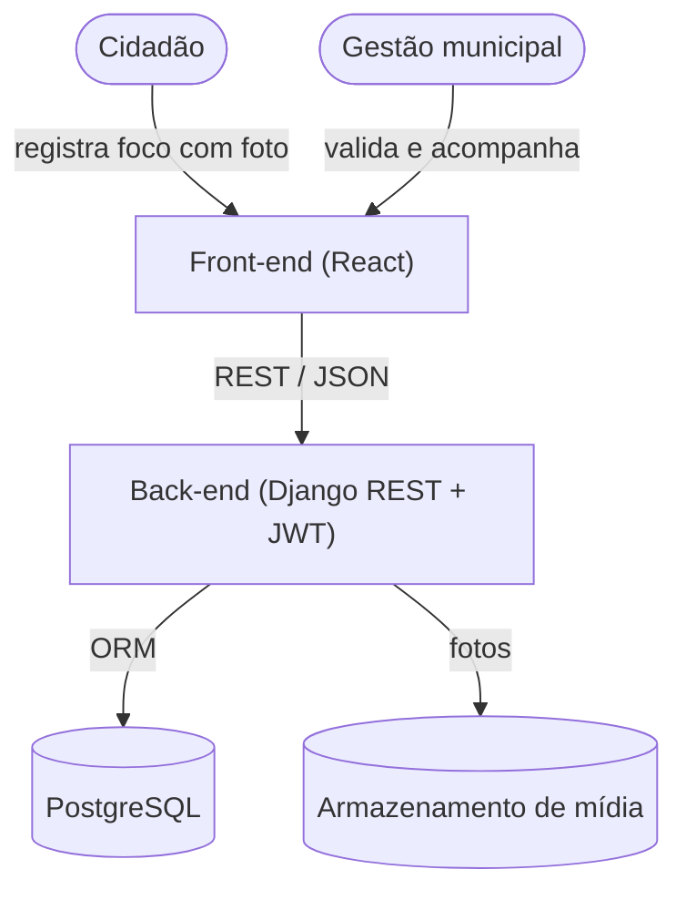
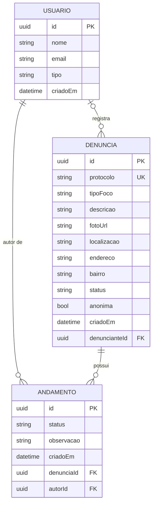

# ContraVetores

> Central de denúncias de focos de proliferação de vetores em Olinda (PE).


---

## Visão Geral

O ContraVetores é uma plataforma web colaborativa onde a população de Olinda registra focos de risco (água parada, lixo acumulado, terrenos baldios, animais peçonhentos) com foto e localização. Os relatos viram dados organizados que orientam a fiscalização da vigilância em saúde e encurtam o tempo entre o surgimento de um foco e a resposta do poder público.

Em uma frase: transformar a população em sensor da cidade, convertendo relato disperso em dado que prioriza a ação dos agentes de saúde.

> [!NOTE]
> Projeto acadêmico de inovação social da UNICAP, com patrocínio simulado da Secretaria de Saúde da Prefeitura de Olinda. É um MVP universitário: o escopo prioriza os requisitos que fazem sentido para o problema, não um produto pronto para produção.

---

## Arquitetura (provisória)

> [!NOTE]
> A arquitetura abaixo é a levantada até o momento e pode evoluir ao longo do desenvolvimento.

### Diagrama de arquitetura



O front-end apresenta o mapa, o formulário de denúncia e o painel. O back-end concentra as regras e a autenticação. Os dados e as consultas geográficas ficam no banco. Nenhuma camada acessa a outra pulando o back-end.

### Stack

| Camada | Tecnologia |
| --- | --- |
| Back-end | Python, Django 5.2, Django REST Framework |
| Autenticação | JWT (djangorestframework-simplejwt) |
| Banco de dados | SQLite em desenvolvimento; PostgreSQL previsto para produção (psycopg) |
| Dados geográficos | djangorestframework-gis (previsto) |
| Upload de imagens | Pillow |
| CORS | django-cors-headers |

### Modelo de dados



- **Usuario**: a gestão municipal e os agentes de saúde que validam as denúncias.
- **Denuncia**: o foco reportado. O `protocolo` é público, para acompanhamento. Pode ser anônima (`anonima`), e nesse caso `denuncianteId` fica vazio (LGPD).
- **Andamento**: o histórico de cada denúncia. Cada mudança de `status` registra quem fez, quando e uma observação. É o que sustenta o fluxo de validação (recebida, validada, rejeitada, resolvida).

> [!NOTE]
> Este é o modelo formalizado que norteia a Etapa 04. O código atual implementa uma versão reduzida (sem `status` e sem `Andamento`) e será migrado para este modelo.

### Estrutura do repositório

```
contravetores/        Configuração do projeto (settings, urls, wsgi, asgi)
denuncias/            App principal
  models.py           Modelos Usuario e Denuncia
  serialyzers.py      Serializers da API
  views.py            Endpoints (criar, consultar, listar)
  admin.py            Configuração do Django Admin
  migrations/         Migrações do banco
media/                Fotos enviadas nas denúncias
manage.py
requirements.txt
```

---

## Setup

```bash
git clone https://github.com/joaocarloss112/ContraVetores
cd ContraVetores

python -m venv venv
source venv/bin/activate        # Windows: venv\Scripts\activate

pip install -r requirements.txt
python manage.py migrate
python manage.py createsuperuser   # cria o acesso da gestão para o /admin
python manage.py runserver
```

A API fica em `http://localhost:8000`. O painel administrativo em `http://localhost:8000/admin/`.

> [!TIP]
> Use o `createsuperuser` para gerar o login da gestão e testar a rota `/api/admin/denuncias` com um token obtido em `/auth/login`.

### Configuração para produção

> [!WARNING]
> O `settings.py` atual é de desenvolvimento: `SECRET_KEY` fixa no código, `DEBUG = True`, `ALLOWED_HOSTS = ['*']` e banco SQLite. Não use essa configuração em produção.

Antes de publicar: mover `SECRET_KEY`, `DEBUG` e `ALLOWED_HOSTS` para variáveis de ambiente, definir `DEBUG = False`, trocar o banco para PostgreSQL (local ou Supabase) via `DATABASE_URL` e servir a mídia por um storage adequado.

---

## Entregas

### Entregue

**Etapa 01/06: Projeto de inovação social** (18/09/2026)
- [x] Proposta ContraVetores, definição e atores de inovação social
- [x] Análise SWOT, agentes de fomento e custo estimado
- [x] Detalhamento do método e pitching

**Etapa 02/06: Escolhas computacionais** (14/10/2026)
- [x] Diagrama de arquitetura (front, back e dados)
- [x] Modelagem de dados inicial e contratos de API
- [x] Protótipo de alta fidelidade (HiFi)

**Etapa 03/06: Mitigação de risco e validação ponta a ponta** (16/10/2026)
- [x] Repositório Git com o core do back-end (Django REST)
- [x] Fluxo de denúncia "happy path" dentro do escopo do HiFi

### Planejado

> [!NOTE]
> Compromissos enxutos, na estratégia de MVP universitário: poucos itens por etapa, para prometer só o que dá para entregar.

**Etapa 04/06: MVP integrado e beta** (28/10/2026)
_Fazer o sistema funcionar de ponta a ponta e testar com usuários reais._
- [x] Desenvolvimento do Front-end (baseado no HiFi entregue).
- [x] Determinar a arquitetura Back-end. (Se der tempo, dados sintéticos, ex seed)
- [x] Aplicação "publicada" disponivel para uso a nivel de desenvolvimento.

**Etapa 05/06: Ensaio e preparação para a banca** (11/11/2026)
_Blindar a aplicação e preparar a apresentação._
- [ ] a definir
- [ ] Curva S do fluxo do usuário
- [ ] Pipeline simples de testes de fluxo do sistema

**Etapa 06/06: Entrega final** (18/11/2026)
_Ajustar e entregar à banca._
- [ ] Ajustes finais a partir do feedback e do ensaio
- [ ] Entrega do projeto à banca externa

---

## Equipe

Gabriel Martins, Rafael Sampaio, João Carlos, Marina Mendes, Lucas Sebastião e Henrique Rojas.
