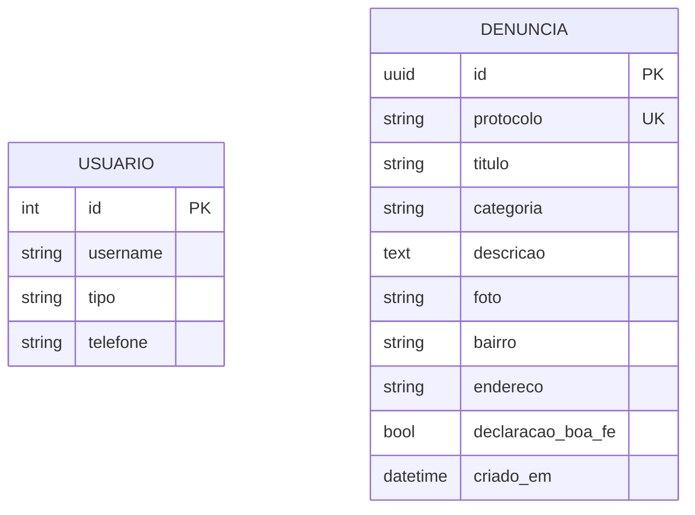

# ContraVetores

> Central de denúncias de focos de proliferação de vetores em Olinda (PE).


Plataforma web colaborativa onde a população registra focos de risco (água parada, lixo acumulado, terrenos baldios, animais peçonhentos) com foto e localização. Os relatos viram dados organizados que orientam a fiscalização da vigilância em saúde e encurtam o tempo entre o surgimento de um foco e a resposta do poder público.

> [!NOTE]
> Projeto acadêmico de inovação social da UNICAP, com patrocínio simulado da Secretaria de Saúde da Prefeitura de Olinda. É um MVP universitário: o escopo prioriza os requisitos que fazem sentido para o problema, não um produto pronto para produção.

## Objetivos (Etapa 04)

- [x] Repositório organizado com README e estrutura clara
- [ ] Banco de dados formalizado (migração de SQLite para PostgreSQL)
- [ ] Fluxos principais (happy paths) validados com persistência real
- [ ] Dados sintéticos baseados em cenários reais de Olinda
- [ ] Integração do front-end (HiFi) ao repositório
- [ ] Painel de indicadores para a gestão municipal

## Arquitetura


O front-end apresenta o mapa, o formulário de denúncia e o painel. O back-end concentra as regras e a autenticação. Os dados e as consultas geográficas ficam no banco. Nenhuma camada acessa a outra pulando o back-end.

## Stack

| Camada | Tecnologia |
| --- | --- |
| Back-end | Python, Django 5.2, Django REST Framework |
| Autenticação | JWT (djangorestframework-simplejwt) |
| Banco de dados | SQLite em desenvolvimento; PostgreSQL previsto para produção (psycopg) |
| Dados geográficos | djangorestframework-gis (previsto) |
| Upload de imagens | Pillow |
| CORS | django-cors-headers |

## Estrutura do repositório

```
contravetores/        Configuração do projeto (settings, urls, wsgi, asgi)
denuncias/            App principal
  models.py           Modelos Usuario e Denuncia
  serialyzers.py      Serializers da API
  views.py            Endpoints (criar, consultar, listar)
  admin.py            Configuração do Django Admin
  migrations/         Migrações do banco
media/                Fotos enviadas nas denúncias
manage.py
requirements.txt
```

## Modelo de dados



**Usuario** (estende o usuário padrão do Django): acesso da gestão municipal, com `tipo` e `telefone`.

**Denuncia**: o foco reportado pela população. É anônima, sem vínculo com usuário. O `protocolo` é um código público gerado automaticamente, usado para acompanhar a denúncia.

> [!NOTE]
> O modelo acima é o estado atual. A ligação entre gestão e denúncia (fluxo de validação por `status`: recebida, validada, rejeitada, resolvida) está no roadmap e ainda não foi implementada.

## API

> [!IMPORTANT]
> Estas são as rotas levantadas até o momento. A API está em construção e os contratos podem mudar conforme o projeto evolui.

| Método | Rota | Acesso | Descrição |
| --- | --- | --- | --- |
| POST | `/api/denuncias` | Público | Registra uma denúncia |
| GET | `/api/denuncias/{protocolo}` | Público | Consulta uma denúncia pelo protocolo |
| GET | `/api/admin/denuncias` | Autenticado | Lista todas as denúncias para a gestão |
| POST | `/auth/login` | Público | Autentica e devolve o token JWT |
| POST | `/auth/refresh` | Público | Renova o token JWT |
| — | `/admin/` | Autenticado | Painel administrativo do Django |

As respostas são em JSON. As rotas autenticadas exigem o header `Authorization: Bearer <token>`.

## Como rodar localmente

```bash
git clone https://github.com/joaocarloss112/ContraVetores
cd ContraVetores

python -m venv venv
source venv/bin/activate        # Windows: venv\Scripts\activate

pip install -r requirements.txt
python manage.py migrate
python manage.py createsuperuser   # cria o acesso da gestão para o /admin
python manage.py runserver
```

A API fica em `http://localhost:8000`. O painel administrativo em `http://localhost:8000/admin/`.

> [!TIP]
> Use o `createsuperuser` para gerar o login da gestão e testar a rota `/api/admin/denuncias` com um token obtido em `/auth/login`.

## Configuração para produção

> [!WARNING]
> O `settings.py` atual é de desenvolvimento: `SECRET_KEY` fixa no código, `DEBUG = True`, `ALLOWED_HOSTS = ['*']` e banco SQLite. Não use essa configuração em produção.

Antes de publicar:
- Mover `SECRET_KEY`, `DEBUG` e `ALLOWED_HOSTS` para variáveis de ambiente.
- Definir `DEBUG = False`.
- Trocar o banco de SQLite para PostgreSQL (local ou hospedado no Supabase), via `DATABASE_URL`.
- Servir os arquivos de mídia por um storage adequado.

## Equipe

Gabriel Martins, Rafael Sampaio, João Carlos, Marina Mendes, Lucas Sebastião e Henrique Rojas.

## Status

MVP universitário em desenvolvimento (Etapa 04). O desenvolvimento segue um método ágil iterativo, com entregas incrementais até dezembro de 2026.
