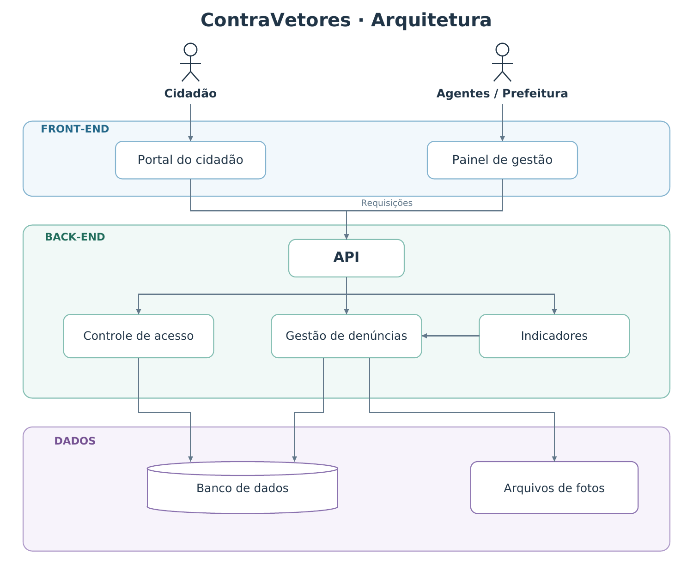
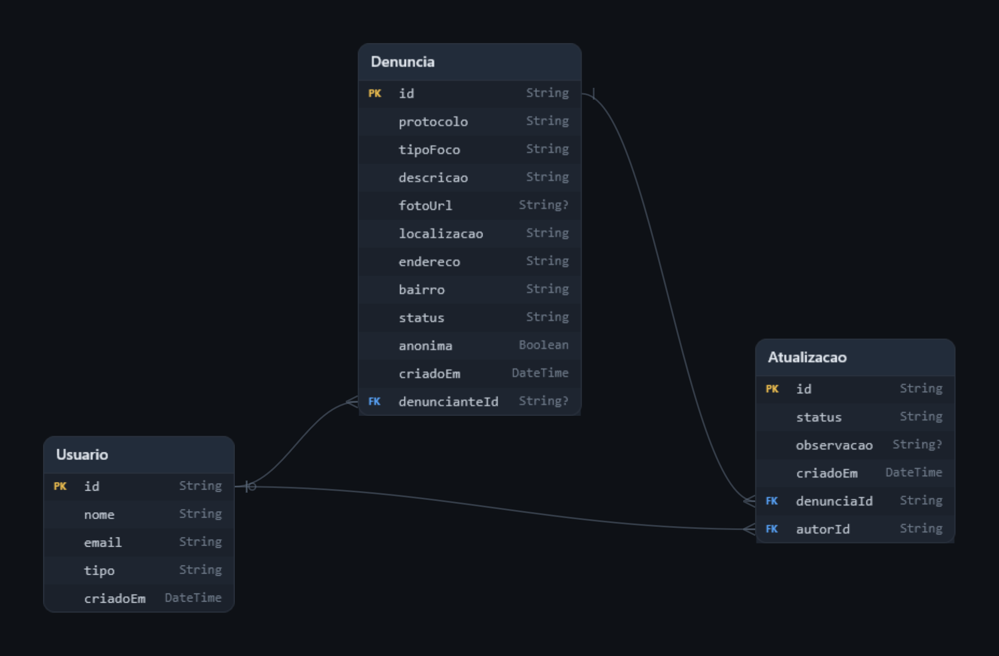

# Escolhas Computacionais

> Documento entregue na **Etapa 02/06** (14/10/2026). Reproduzido aqui como foi entregue. O que mudou na implementação está registrado no [README](../../README.md#stack).

ContraVetores, Olinda · Gabriel Martins, Rafael Sampaio, João Carlos, Marina Mendes, Lucas Sebastião, Henrique Rojas

## Objetivo

Formalizar as escolhas computacionais que sustentam o problema social já delimitado: a demora entre o surgimento de um foco de proliferação de vetores em Olinda e a resposta da vigilância em saúde. O ContraVetores permite à população registrar focos com foto e geolocalização, e direciona a fiscalização para onde ela é mais necessária. Cada tecnologia abaixo foi escolhida com uma justificativa técnica ligada a essa finalidade.

## Separação de responsabilidades

- **Front-end:** apresenta o mapa, o formulário de denúncia e o painel da Prefeitura. Não acessa o banco diretamente.
- **Back-end:** concentra as regras de negócio (registro e validação das denúncias, priorização, indicadores) e a autenticação.
- **Dados:** guarda as denúncias e responde às consultas geográficas, como foco mais próximo e agrupamento por bairro.

## Stack tecnológica

| Camada | Tecnologia | Justificativa |
| --- | --- | --- |
| Front-end | **React** | Componentização e responsividade mobile-first, com boas bibliotecas de mapas para a interface pública. |
| Back-end | **Python + Django** | Framework robusto, ORM integrado e ecossistema maduro para construir a API REST. |
| Dados | **PostgreSQL + PostGIS** | Suporte nativo a dados geoespaciais (foco mais próximo, por bairro), confiabilidade e escalabilidade. |
| Geolocalização | **Leaflet + OpenStreetMap** | Gratuito, sem limite de requisições e com integração direta ao PostGIS. |
| Dashboard | **Power BI** | Visualização de indicadores para a tomada de decisão pela Prefeitura. |

## Diagrama de arquitetura

Versão em PDF: [arquitetura.pdf](arquitetura.pdf)

## Modelagem de dados (como entregue)

